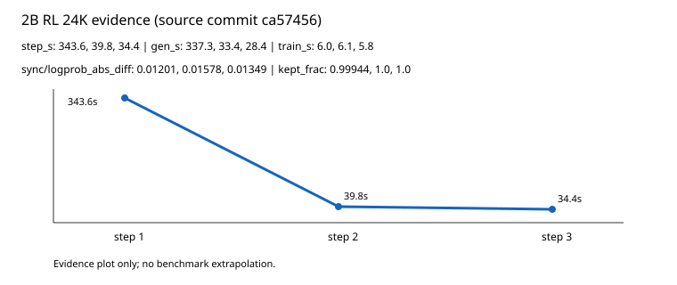

# 第 9 章：DPPO 训练中的证据、同步与排障

本章只报告可追溯的训练记录，不把示意图或读者运行结果写成历史指标。所有数字均来自私有取证仓库的路径和提交号，公开稿不包含私有 URL、账号、主机名或凭据。

## 9.1 记录边界

[记录事实] 本章使用的最小公开数据快照为 `cluster1900/qwen-posttrain` 提交 `ca57456` 的 `result/round2/results/rl_2b_24k_metrics.jsonl`。字段筛选、样本范围和净化结果见 `data/ch09_rl_2b_24k_metrics.json`。该文件保留 step、reward、useful group、keep ratio、同步差异以及生成/训练/总耗时。

[作者分析] 这些记录覆盖 2B、24K 配置的 3 个 step，不能外推为所有模型、所有序列长度或稳定吞吐基准。

## 9.2 三条真实曲线

图 9-1 使用同一快照绘制三类曲线：每步 reward_mean 与 useful_groups/groups；DPPO 保留比例 train/kept_frac；采样器与训练器同步差异 sync/logprob_abs_diff。图 9-2 给出同一批次的 gen_s、train_s、step_s 拆分。绘图脚本为 `scripts/figures/ch09_rl_2b_24k.py`，测试为 `tests/test_ch09_real_metrics.py`。



[记录事实] reward_mean 在三个 step 均为 0.5，useful_groups/groups 均为 2/2；kept_frac 为 0.9994359842、1.0、1.0；同步差异为 0.0120108180、0.0157821982、0.0134856769。

[记录事实] step_s 分别为 343.6、39.8、34.4 秒，其中 gen_s 为 337.3、33.4、28.4 秒，train_s 为 6.0、6.1、5.8 秒。第一步采样耗时占主导，不能用 train_s 代替端到端耗时。

## 9.3 从现象到检查

1. [读者运行所得] 运行测试只能验证净化 JSON 的字段约束与来源标记；它不会重新运行私有训练。
2. [记录事实] keep ratio 接近 1 并不等于每个 rollout 都有效，必须同时查看 useful_groups/groups、truncated_frac 和 format_errors。
3. [作者分析] 发现同步差异上升时，应优先记录 vLLM 与训练器的版本、tokenizer、采样参数和 checkpoint 边界，再比较 `sync/logprob_abs_diff`；本章不据此设定未在源记录中出现的阈值。
4. [作者分析] 总耗时应按生成、训练和其他固定开销拆分；只有训练耗时而没有生成耗时的表格不足以支持资源结论。

## 9.4 可复现实验接口

在获得授权的取证副本后，按源路径和提交号导出字段，再运行：

```text
python scripts/figures/ch09_rl_2b_24k.py
pytest -q tests/test_ch09_real_metrics.py
```

脚本输出每条曲线的 step:value 序列，并重建图 9-1。若源文件内容或提交号变化，应先更新净化数据和 provenance，再更新正文，不要手工改图上的数字。

## 9.5 限制与待补证

[记录事实] 当前快照没有独立 GPU 账单、完整无沙箱 rehearsal 计数或所有训练命令行，因此本章不声称成本、吞吐或命令参数已经完整复现。

[作者分析] 后续若补入其他模型或轮次，应保持同一字段命名和 provenance 结构，并将每个结论标注为记录事实、读者运行所得或作者分析。
