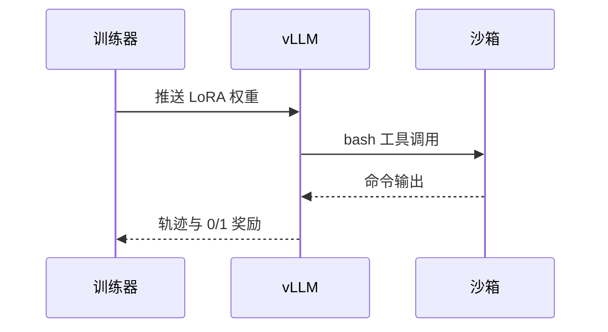

# 构建样章：三种格式的渲染自检

本文件只用于 CI 的构建自检（`python3 build.py --src tests/build_fixture`），不进正式书稿。它覆盖中文正文、Mermaid 图、公式、代码和表格，用来确认网页、EPUB 和 PDF 都能正确显示，PDF 不缺中文字形。

## 中文与标点

后训练（post-training）把基座模型变成会用工具的智能体。常用标点：，。、；：？！“引号”‘单引号’《书名号》（括号）——破折号……省略号。生僻一些的字：龘、鑫、彧、喆、甦、𠮷。

## 流程图

```{.mermaid #fig-pipeline caption="图 A-1　Apexo 后训练流程总览（自检用示意图）"}
flowchart LR
  D[数据冻结<br/>14,401 条任务] --> S[LoRA SFT 预热]
  S --> R[Apexo RL<br/>DPPO 八步]
  R --> E[Terminal-Bench 2.0<br/>89 任务 × 5 次]
  E -->|门禁通过| OK((发布))
  E -->|门禁失败| S
```

## 时序图



## 公式

无偏 pass@k 估计：

$$\text{pass@}k = \mathbb{E}_{\text{任务}}\left[1 - \frac{\binom{n-c}{k}}{\binom{n}{k}}\right]$$

k3 KL 估计：$\mathrm{KL} \approx e^{d} - d - 1$，其中 $d = \log \pi_{\mathrm{ref}} - \log \pi$。

## 代码

```python
import torch

# 只对 assistant 段计算交叉熵（中文注释也要能显示）
logits = torch.randn(2, 5, 10)
labels = torch.tensor([[-100, 1, 2, 3, -100], [4, 5, -100, 6, 7]])
loss = torch.nn.functional.cross_entropy(logits.view(-1, 10), labels.view(-1), ignore_index=-100)
print(f"损失 = {loss.item():.4f}")
```

## 表格

| 信号 | 公式 | 阈值 |
| --- | --- | --- |
| 有效调用率 | 1 − 格式错误步数 / 总步数 | ≥ 96% |
| 无工具调用率 | 最近 10 步平均 | ≤ 10% |

## 本章出处

- 本书 `build.py`（自检样章，无源仓库素材）。
